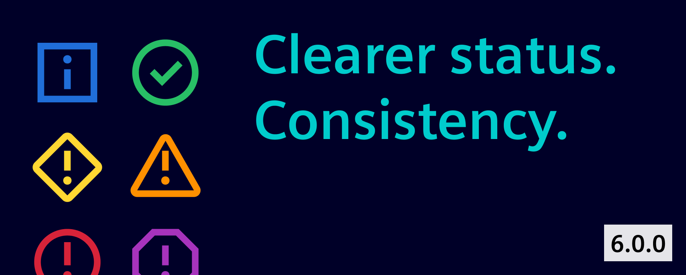
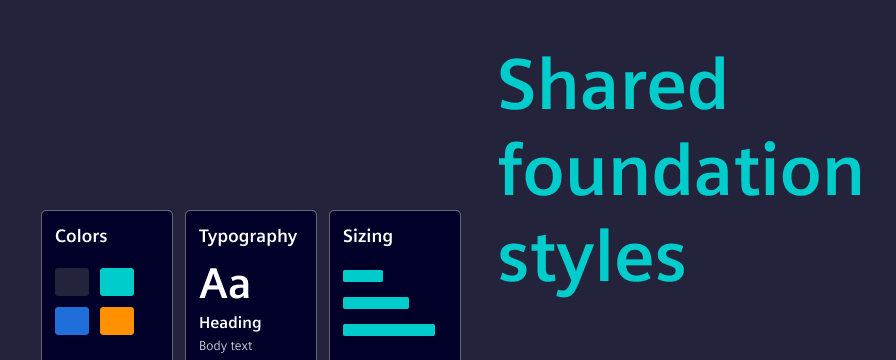
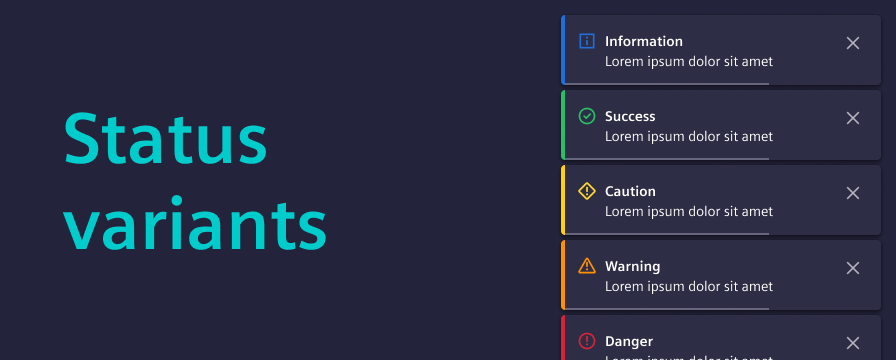
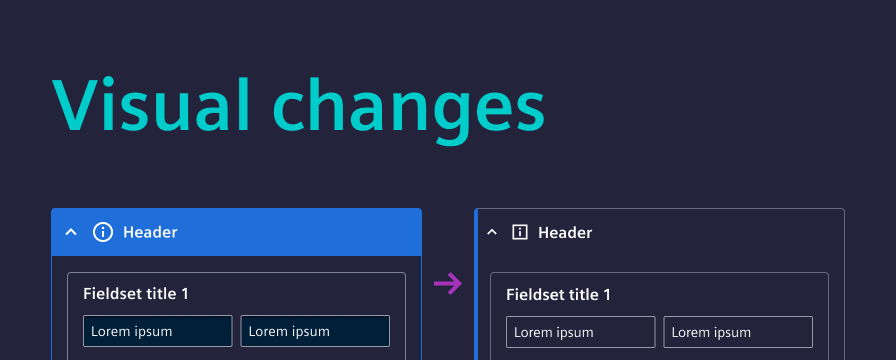
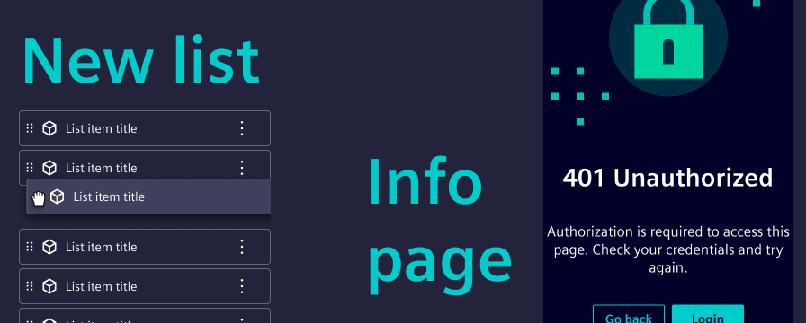
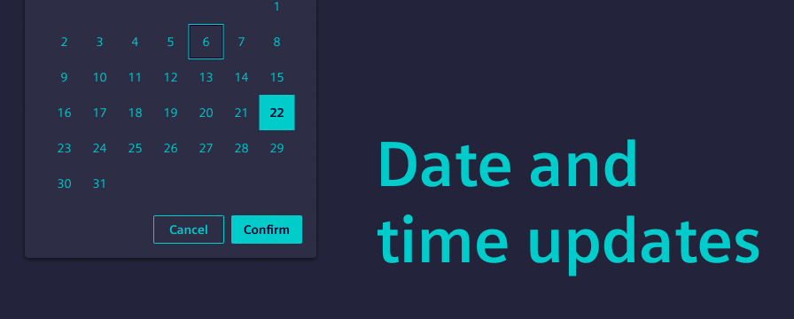
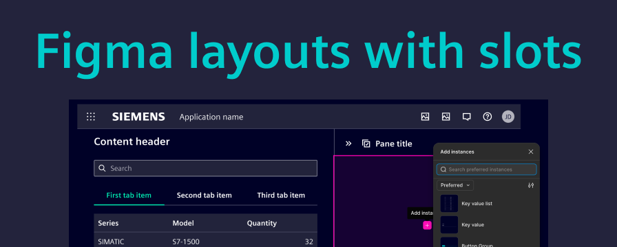

# Release V6.0.0

Version 6 brings a more consistent visual language to Siemens Industrial Experience. Shared Siemens Design Language tokens, aligned icons and broader status support help teams communicate the same meaning across components, screens and products.

Alongside this visual refresh, V6 introduces new components and improves everyday interactions, accessibility and form handling. Usability, performance and framework integration fixes round out the release.

<!-- truncate -->

## One shared foundation

Version 6 continues our path toward closer alignment with Siemens Design Language. Building on the shared reference colors introduced in previous versions, it replaces legacy iX design tokens with Siemens Design Language system tokens.

The updated foundation adopts **system tokens** and introduces the renamed **Community theme** which previously known as Classic theme. More modular stylesheets also give developers greater flexibility in how they integrate styles.

Colors, typography and effects now draw on a shared foundation. The updated status variants make this connection tangible. Their colors and icons follow Siemens Design Language, bringing a shared visual vocabulary directly into the products.

## Recognizable status across the interface

A status should not need a new interpretation every time it appears in a different component. V6 aligns status names, colors and icons and adds missing variants across more components.

The shared status includes **accent, neutral, information, success, caution, warning, danger and critical**. Updated and expanded options reach from [cards](/docs/components/card) and [blinds](/docs/components/blind) to [badges](/docs/components/badge), [chips](/docs/components/chip), [KPIs](/docs/components/kpi) and feedback such as [message bars](/docs/components/messagebar) and [toasts](/docs/components/toast). Available variants depend on the component.

**Preserve meaning when migrating:** some familiar names now mean something different. The previous `warning` becomes `caution`, `critical` becomes `warning`, and `alarm` becomes `danger`. The new `critical` is an additional status. Use the [migration guide](/docs/home/migration/6_0_0) to choose the right replacement for your application's intent.

## Visual changes for a coherent experience

Color is only part of the story. We have also aligned status icon shapes with Siemens Design Language. The **information icon is now square**, helping distinguish it from the alarm icon and making status recognition less dependent on color alone.

Across affected components, the default icon size moves from **24px to 20px**, bringing a more consistent balance between icons, labels and surrounding content. Smaller glyphs do not automatically mean smaller interaction targets: icon buttons retain their 32px host, while checkboxes and radio buttons retain their 24px hit area.

Cards, blinds and toasts also communicate status more selectively. A **colored stripe replaces the full status-color fill**, keeping the signal visible while giving the content more visual space.

Decorative shadows have been removed from inputs, selects, expanding search and chat inputs, and the focus outline now uses a 2px width with a 1px offset.

The improvements extend beyond appearance. Responsive content-header actions, context-menu dropdown positioning and configurable dropdown keyboard navigation give teams more control over interactions across layouts.

Application skip links, semantic headings and clearer screen-reader labels improve accessibility, alongside refinements to keyboard navigation and focus handling.

## New components: List and info page

V6 introduces the [**List**](/docs/components/list) component (`ix-list` and `ix-list-item`) for presenting related items in a scannable vertical layout. Items can combine icons, labels, descriptions, status badges and actions, or use custom content for layouts such as notifications and events.

Ghost, filled and outline variants help lists fit their surrounding surface. Optional checkboxes, item selection and drag-and-drop reordering support different workflows, with keyboard navigation and keyboard-based reordering built in.

The new **Info page** component (`ix-info-page`) supports informational page states, helping teams communicate context at the page level.

## More control in date and time selection

V6 also improves how users select dates and times. Separate display formats, updated locale support and locale-independent ISO fields help teams connect localized interfaces to application data.

Optional confirmation in date and date-time components lets users review a selection before applying it. Time-only pickers and inputs always require confirmation, with cancellation discarding pending selections. That creates a clear distinction between exploring a value and committing a change.

Input clearing and more reliable validation also make forms easier to work with. Performance improvements help pages with many date and time inputs stay responsive.

## Flexibility with Figma slots and layout templates

For designers, V6 extends the **native Figma slots** introduced in V5 to more components. Content can be added directly to instances without detaching them or building custom content-replacement components, making it easier to compose realistic screens while staying connected to library updates. With the slot option we are also introducing new layout templates in Figma.

## Make the move to V6

V6 is an opportunity to bring your application onto a shared design foundation and communicate status more consistently, from the smallest badge to a complete operational view.

Behind the visible changes, native animations replace animation dependencies, and framework-specific fixes improve integration reliability.

Start with the [V6 migration guide](/docs/home/migration/6_0_0) for breaking changes. For the **full list of changes**, visit the [Siemens iX releases page on GitHub](https://github.com/siemens/ix/releases).

We are also updating the **"Since" tags in the component documentation** to help identify when a component or property was introduced. These complement the changelogs when exploring APIs, but do not replace the full record of fixes and behavior changes.

A shared foundation. Clearer status signals. More consistent components. That is the next step with Industrial Experience V6.
